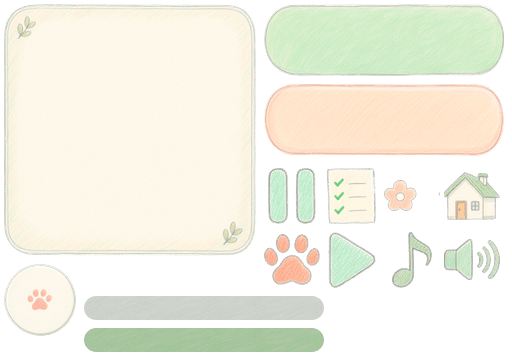

# UI 视觉样式规范

版本：v1.1 · 2026-11-23。**UI 设计、界面实现、换肤、UI 素材制作/替换及相关 Review 前必读。** 适用于地图、清障、回合救助、救助站、加载界面和共享弹窗；独立美术试验可以探索新风格，但候选不能直接成为正式界面的第二套皮肤。

## 1. 使用规则

当前统一方向为用户已选择的**清新可爱手绘版**：奶油纸底、浅鼠尾草绿主操作、浅杏色次操作、深绿文字，细线稿与轻纸纹。沿用当前素材，不重新选画风。

| 规则归属 | 负责的内容 |
| --- | --- |
| 本文 | 画风、材质、颜色语义、组件外观、状态、资源选用和样式验收 |
| [UI 排版与可读性规范](UI排版与可读性规范.md) | 信息层级、字号、间距、热区、安全区、容量重排和对比度底线 |
| [UI 工程专题](conventions/topics/ui.md) | 静态 Prefab、绑定、弹窗管理、输入、复用和生命周期 |

三份规则同时适用。**必须**是验收要求；**默认**是后续统一起点，有明确用途差异时沿用协作任务记录例外、影响范围和验证，不新增逐次审批流程。用户最新要求优先。

新界面和改动到的同类组件按本文执行；存量须检查后再记录达标。v1.0发布时只补规范；v1.1随[站内反馈与字体整改](救助站反馈与字体优化.md)更新纸按钮禁用态、默认字体及设置接线。继续使用静态Prefab与共享配置。

## 2. 画风与材质

- **画面主体**是动物与现场。UI 轻巧、紧凑，依内容收口；手绘装饰只出现在纸边、角落或小图案，不挤占正文和触控面积。
- **纸板**使用暖奶油色、浅纹理、柔和的不规则边缘。**按钮**使用同一套圆润纸边和轻微彩铅纹理。线条、转角和阴影以现有切片为样本，不在各模块另定一套圆角、描边和投影。
- **颜色**低饱和、偏暖；表达状态时使用清楚的深色文字/图形。柔和画风不能以弱对比、半透明正文或细到看不清的线条实现。
- 同屏避免混入高光塑料、金属浮雕、霓虹、厚黑描边和强外发光。清新版是保留候选，不与当前手绘按钮/纸板随意混搭。
- 地点可以更换背景、家具和场景装饰。通用按钮、纸板、关闭方式、状态颜色与反馈继续一致；森林和车棚不能各有一套确认按钮。
- Loading 可用完整插画和专用演示动效；若出现通用按钮、提示或错误弹窗，同样遵守本文。场景插画的局部色调不改写操作颜色语义。

当前资源样本（整页预览，非需要整张显示的运行控件）：

## 3. 颜色角色

以下名称用于设计和 Review，不表示工程中已经存在同名 API。已有颜色通过共享配置/静态控件引用；新增样式参数应有一个共享归属，不在每个面板复制常量。

### 3.1 文字、底板与语义色

| 角色 | 默认值或资源 | 使用规则与当前状态 |
| --- | --- | --- |
| 主文字/单色功能图标 | `#2A3D30`，不透明 | 当前 `LayoutMetrics.ink`；标题、正文和浅底按钮文字统一使用 |
| 次级文字 | `#384D41`，不透明 | 当前节奏设置辅助说明已有该色；用于次级信息，不能靠降低整组透明度区分层级 |
| 纸底 | `Paper`，白色 tint | 中心抽样约 `#FDF8E9`；保留原纹理，不能用抽样色覆盖整张图 |
| 主操作底 | `Action`，白色 tint | 中心约 `#D1EDC9`；每个同时可见的操作组默认一个主动作 |
| 次操作底 | `Secondary`，白色 tint | 中心约 `#FFE3C9`；返回、查看、设置等非主动作 |
| 选中标记 | `#384D41` + 边框/勾选 | 颜色和形状同时表达；不能与普通按钮的 hover/焦点混淆 |
| 注意/风险文字 | `#8E4D30` | 既有编辑器设置提示使用过的暖棕；后续统一目标，现存 Prefab 是否使用须逐项核对 |
| 错误/危险文字 | `#9C4137` | 当前 `LayoutMetrics.errorInk`，已用于站内阻断错误；配明确错误内容，不把整页涂红 |
| 成功/完成文字 | `#376947` | 本规范新增的默认语义色，尚未统一接入；配完成文字或图形，不只变绿 |
| 模态遮暗 | 纯黑，alpha `88/255` | 沿用[全屏遮罩约定](conventions/topics/ui.md#s-6-3)，不在模块内重新调透明度 |

三个底色是当前 PNG 中央 16×16 不透明像素的中位数，供色板比较；不是整张纹理的固定色，更不是实际合成画面已通过对比验收。按这三个参考底色，深绿主文字约 9.2–10.9:1，白字仅约 1.1–1.3:1，**浅绿主按钮同样使用深字，不能默认换白字**。

警告、错误、成功色只用于对应语义。动物、费用、选中项不借用错误红或奖励金制造强度；不由样式新增货币、稀有度或健康规则。彩色图标中的绿色也不能单独作为“已完成”的唯一信号。

### 3.2 按钮底图状态 tint

下表由共享 `LayoutMetrics` 定义。站内、地图、清障/救助及共享弹窗中使用Action/Secondary的纸按钮已接 `PaperButtonState`；CanvasGroup造成的不可用也应用同一规则。tint与纹理相乘，不能将表中颜色当最终底色；旧白板和非纸质场景交互区不套纸按钮皮肤。

| 状态 | 底图 tint | 额外要求 |
| --- | --- | --- |
| 普通 | `#FFFFFF` / alpha 1 | 保留原图，不染文字和图标 |
| hover | `#F9F9F2` / alpha 1 | 仅增强鼠标反馈；触屏不需要 hover 才能辨认按钮 |
| 按下 | `#D3E4D6` / alpha 1 | 配共享 Press；不挪动命中区域 |
| 禁用 | 换共享 `Paper`，tint `#F5F2E9` / alpha 1 | Selectable.disabledColor保持白色，文字保持深绿；用浅纸底降低强调，保留必要原因。禁止绿色/杏色纹理再乘暗灰或整体降低透明度 |
| 键盘/手柄焦点（如启用） | 普通 tint + 独立焦点边框 | Unity `SelectedColor` 不代表业务“已选”；是否支持这些输入另按工程事实 |

业务选中、开关开启、拖放落点有效是独立状态，在正常/按下等输入状态上叠加持续可见的形状标记；不靠换一个 `SelectedColor` 假装完成业务绑定。

## 4. 文字、图标、轮廓与阴影

- 字体统一绑定 [PetRound-Game.ttf](../unity/HomelessPetHelper/Assets/Art/Fonts/PetRound-Game.ttf)，由免费商用SIL OFL1.1的寒蝉全圆体裁剪、重命名而来；一套常规字重兼顾可爱和正文可读性。字号/行高按排版规范；不以系统字体、Emoji或缺字方块代替功能图标。新增文案须重建子集并检查短屏换行、缺字与动态图集；完整源字库留证据目录，不导入Assets。许可与可复现命令见[字体记录](../unity/HomelessPetHelper/Assets/Art/Fonts/README.md)。
- 同角色字色、对齐和字重一致。标题通过字号与间距形成层级，不再叠渐变、外发光和粗阴影；不把标题/按钮/数值烘进底图。
- 彩色手绘图标默认白色 tint，保留源图色彩；专门设计的单色符号才用主文字色。不能把彩色图标强染成一块深绿，也不能在不同入口混用线性、实心和 Emoji 三种图标体系。
- 同尺寸图标比较**实际可见图形**的大小、线条密度和光学居中；不能按 PNG 透明画布简单填满。图标比例与热区分别控制，尺寸遵循排版规范。
- `Pause` 表示暂停，`Objectives` 表示目标/清单，`Settings` 表示设置，`Home` 表示回站，`Play` 表示继续/行动；`Music`/`Speaker` 表示对应声音项。同一个入口不能因页面不同换一个不相干图标。复合站内菜单若继续用齿轮，需有可发现的菜单含义说明，不把它当作所有杂项入口的默认符号。
- 爪印、行动符号和费用图形沿用已确定的业务含义。费用图标走[排版规范 §5.2](UI排版与可读性规范.md#52-费用资源图标加数字)，不因“可爱”而互换。
- 普通边框和阴影以共享切片自身为准，不额外叠硬黑框和多层投影。选中/焦点标记默认用单层深色轮廓，基准起点 1 L / 3 U，避开纸边并实测清晰度；必要状态图形须满足排版规范的对比要求。装饰纹理不承担唯一的状态识别。

## 5. 组件样式目录

| 组件 | 统一外观与行为约束 | 当前可复用入口 |
| --- | --- | --- |
| 普通弹窗/详情/总结 | `Paper` 内容底板、深字、单层标题、稳定关闭；按内容收口，正文长时滚动；操作区不滚没 | 关卡 `Widget_LevelOverlays`；站内已有详情/菜单/总结 |
| 主按钮 | `Action` + 深字；只突出本组下一步主动作；正常/按下/禁用有区别 | 现有 Prefab 中已绑定的纸按钮，不假设已有独立通用按钮 Prefab |
| 次按钮 | `Secondary` + 同字号深字；普通次动作不再另配蓝色/灰色按钮 | 同上 |
| 危险确认 | 普通纸弹窗 + 明确后果，确认文字/提示使用危险语义；保留取消和统一返回顺序 | 既有确认页面；未有独立危险底图，不临时拼强红塑料按钮 |
| 图标入口/关闭 | 同体系图标或统一关闭字符，配浅杏底或现有轻底；视觉可小，热区不缩 | 现有暂停/目标/菜单/关闭控件 |
| 手牌/可选卡片 | 纸卡图文层级，选中加轮廓/标记，不同卡不各配不同材质；费用保持动态图标与数字 | 现有救助手牌 Cell 与共享动效 |
| Toggle/单选 | 同一页统一浅底、明确勾选/开关状态和文字标签；不能只改变底色 | 既有设置/暂停 Toggle；不同语义分别保留 |
| 滑块 | `VolumeTrack` 空轨、`VolumeFill` 填充、`VolumeThumb` 手柄；同端点，0 不留假填充；手柄保持比例 | 现有音量控件，值/静音样式与业务状态同步 |
| 进度条 | 暖纸/浅轨 + 对应填充，保留含义和必要数字；不同进度有图标/文字区分 | 既有双蓄力/护理进度；不擅改进度语义 |
| 普通 Toast | 短纸条、正文深字、单行、轻淡入淡出、不遮暗、不拦操作 | `Widget_Toast` / `ToastView`；接入边界见[使用说明](通用Toast使用.md) |
| 指引气泡 | 轻纸底、当前步骤短文；颜色/阴影弱于目标高亮，避让允许操作的内容 | 既有指引与 GuideMask；不与 Toast 混用输入限制 |
| 阻断错误/待确认提示 | 内容持续可读，给出原因和后续动作；显示不依赖已冻结的玩法/Toast时钟 | 站内已接独立阻断纸板，覆盖真实加载/保存失败；不宣称所有模块已有通用错误弹窗 |
| 状态标签/空列表 | 简短状态加稳定图形/文字，空内容不留无意义大纸板，恢复后清除旧状态 | 各面板现有状态区；同类标签不得各自发明颜色 |

模态弹窗/强指引/普通提示按不同职责管理，样式统一不表示合成一个万能弹窗。暂停只承载暂停与设置；长规则、目标、错误有自己的合适入口。多层弹窗共用遮暗、子层不重复叠黑，见工程专题。

## 6. 组件状态矩阵

设计与实现必须一起检查实际支持的状态；不适用项标明原因，不做只含普通态的样式交付。

| 状态 | 玩家看到什么 | 输入/生命周期 |
| --- | --- | --- |
| 普通 | 本组件标准材质、深字、清晰语义 | 可用操作可辨认 |
| hover / 按下 | 轻变色与对应共享缩放 | 触屏独立成立，热区稳定；离开/取消后复位 |
| 业务选中 / 开启 | 持续轮廓、勾选或明确状态文字 | 与 hover、Unity 焦点、按住、已提交分开 |
| 不可用 / 锁定 | 低强调底图 + 可读名称 + 必要原因/解除条件 | 业务拒绝不悄悄忽略；洗和梳等独立动作分别解释 |
| 进行中 / 等待 | 当前动作与进度/等待状态清楚 | 不重复提交；异步完成/失败由业务决定，动画不代替结果 |
| 成功 / 完成 | 完成图形或结果文字，可附轻反馈 | 不只闪绿；可恢复的结果按业务持久化，不靠特效保存 |
| 警告 / 错误 | 明确文字、对应语义色/图形，重要内容可持续查看 | 保存失败等阻断态即使停用操作也必须显示原因 |
| 关闭 / 重用 / 中断 | 无遗留高亮、变形、旧提示和音效 | 禁用、池复用、失焦、后台、返回与重开按现有生命周期复位 |

## 7. 动效与声音

- 视觉反馈复用 `LevelMotion.asset`、`MotionScope` 与 `UiMotionFeedback`，不在每页新写一套 hover/按下动画或每按钮新增 AudioSource。
- 现有 Hover 为 0.12 秒/目标缩放 1.025，Press 为 0.08 秒/0.955，Selected 为 0.14 秒/1.02；这些是当前共享资产事实，曲线/回弹仍以资产为准。修改共享参数需检查所有使用者，不能只看一个按钮。
- 动效只操作视觉子层，命中根、布局尺寸与指引目标不随之漂移；Mask 内按[排版规范 §7](UI排版与可读性规范.md#7-画风与工程落地)验完整轨迹、两端、短长屏，不能关闭裁切规避。
- 普通操作用现有 `ui.tap`，打开弹窗可用已有 `ui.open`，沿用音频作用域；遮罩空白关闭等入口按既有契约静默。不可用按钮不播成功反馈，不让装饰脉冲反复触发音效。
- 暂停冻结场景与暂停后仍需可读/可点的 UI 分开；样式发布不代表新增“减少动态效果”设置或修改暂停规则。重要提示不能在 alpha 0 时随玩法一起冻结。

## 8. 资源与实现的唯一入口

Unity 资源路径均相对 `unity/HomelessPetHelper/`：

| 内容 | 当前来源 | 后续约束 |
| --- | --- | --- |
| 手绘底板/图标/滑块 | `Assets/Art/UI/T_UI_LevelControls.png`；14切片见[清单](../unity/HomelessPetHelper/Assets/Art/UI/LevelControlsSlices.json) | `Paper`/`Action`/`Secondary` 用九宫格；图标与手柄保比例。切片 border 的像素数不等同内容 padding 或 Canvas 单位 |
| 字号/间距/主文字 | `Assets/Settings/UI/LayoutMetrics.asset` | 同时持有buttonHover/buttonPressed/disabledPaperTint/disabledButtonPaper/errorInk；继续复用，不另建局部主题 |
| 动效 | `Assets/Settings/UI/LevelMotion.asset` | 共享定义、实例独立进度；不复制每面板一份默认库 |
| 共享弹窗 | `Assets/Prefabs/Widgets/Widget_LevelOverlays.prefab` | 保留栈、射线、安全区与已有业务绑定 |
| 共享 Toast | `Assets/Prefabs/Widgets/Widget_Toast.prefab` | 按既有显式引用与定位契约使用 |
| 字体 | `Assets/Art/Fonts/PetRound-Game.ttf` | 738字形子集；新文案核对缺字与[字库来源/生成](../unity/HomelessPetHelper/Assets/Art/Fonts/README.md)；不在界面临时换字体 |

已有完整组件先复用完整组件；普通纸按钮尚无统一独立 Prefab 时，复用当前已保存结构与引用并按本文核对，不复制旧 Editor 构造器来生成一套新默认值。`LevelOverlaySkin`、`StationUiSkin` 等作者工具记录不同阶段，**静态 Prefab 与当前规范是检查依据，旧工具的默认值不自动成为标准**。

新增颜色/状态/控件先查已有共享归属；确实缺少时，在获授权的实现任务中补到合适共享配置或静态组件并同步使用者。本规范不要求为了颜色新增全局单例、动态皮肤框架或运行时拼 UI。当前错误色已接站内阻断页，成功色仍仅有文档定义；后续接入须有实际验证。

后续确需 ComfyUI 补 UI 图时，附当前手绘控件页作风格参考，说明用途、尺寸、切片/九宫格、透明留边与所需状态，禁止带文字/数字。每次先用共享按钮、纸板、图标并排比对线条/纹理/光影；不得每个页面整套重生。按[图片台账流程](../art-source/README.md)独立记录与验收，不能因符合画风就自动算正式许可/首批通过。

## 9. 开工与验收清单

开工时在自己的任务记录写明：采用本文版本、复用的控件/切片与配置、需要新增的样式及其共享归属。变更例外沿用原记录，不另造一份局部规范。

- [ ] 和当前手绘页、共享暂停/设置、站内详情并排看：材质、线条、色调、文字和按钮层级一致；跨模块相同动作看起来一致。
- [ ] 每个操作组主次清楚；浅底深字、必要图形清楚；不通过透明文字/粗描边救对比，按实际合成背景核对。
- [ ] 同类控件检查普通、hover、按下、业务选中、禁用、进行中、完成与错误；触屏缺少 hover 时仍然清楚。
- [ ] 禁用原因具体到动作；保存失败等阻断路径可实际读到错误，不能只断言 Text 已赋值。错误与恢复、旧状态清理一起检查。
- [ ] 弹窗、Toast、指引各守职责；全屏黑遮只有约定的一层。图标含义可发现、字体不缺字、数字/文字独立于图片。
- [ ] 长文/短屏/长屏/平板和模拟安全区可用；Mask 中完整动效不裁，热区固定。具体尺寸与比例按排版规范执行。
- [ ] 静态资源/Prefab引用与当前规则一致；未使用旧重建工具覆盖图片绑定，没有各模块新增私有样式常量。
- [ ] 交付附关键状态的实际运行图与结果，说明整改到哪些界面、哪些仍待；文档发布、编辑器图和真机验收分别记录。

## 10. v1.0发布时的核对与存量边界（历史）

本规范依据已确认的[手绘接入记录](紧凑UI与水彩控件.md)、[动效契约](关卡表现与轻动效.md)、现有共享资产及 2026-11-23 静态 Prefab 只读核对编写。沿用[排版规范的公开参考](UI排版与可读性规范.md#sources)中关于一致性、语义和可读性的原则；项目画风/配色是本项目选择，本轮未另做联网调研。

当前关卡/站内的正文均已使用共享深绿与同一字体，但**按钮状态 tint 仍有分歧**；旧作者工具也保留过不同文字色/状态值。通用危险确认皮肤、完整样式资产和统一关闭图标尚不能称为全部接入。救助站已确认的[保存失败提示与禁用说明问题](救助站UI规范复核.md)继续待修，不因本规范发布自动消失。

本轮无运行资源改动。只读输入指纹、色板抽样/对比参考与文档检查在 `test-results/ui-style-standard/`；未进行批量换肤、全量 Unity 回归或手机/微信验收。后续按“共享组件→关卡通用弹窗→站内→地图/加载同类控件”的依赖顺序逐处整改；该顺序是建议，不自动扩大本轮写入授权。

## 11. v1.1整改记录

用户要求处理站内反馈、禁用偏黑并寻找免费可爱字体。已统一现用纸按钮状态、接入738字形圆体子集、补站内错误/护理说明与已有设置层级。具体覆盖、运行证据、字体来源/许可和Editor测量见[整改记录](救助站反馈与字体优化.md)。v1.0章节保留为发布时事实；观察位的场景美术精修、通用危险确认皮肤和真机验收仍未完成。
