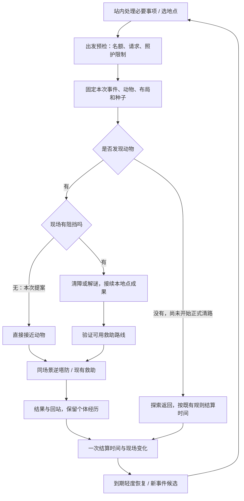

# 正式关卡设计与重复游玩方案

2026-11-22，设计稿 v0.2。基于已拉取的 `5fafb8f` 与保留的本地场地/动物连续状态、关卡可见性改动。用户要求进入正式关卡设计，考虑所有地图玩过后的反复游玩；随后认可方案，并补充逆塔防界面的调整须一起做。成果保留、轻量回访、模板轮换及首批三地点六样本作为接下来实施方向，具体布局与数值经验证/试玩调整；当前尚未将新刷新、关卡选择或解谜重访规则写进运行时。

## 1. 建议先确定的体验

地图是持续生活的地方，关卡是某次发生在这里的救助。走遍六处地点后，仍能接到新事件、再次遇见未救成的动物；同一个地方的空间布局让玩家逐渐熟悉，但这次被什么挡住、需要怎样接近动物可以不同。

推荐采用“手工设计模板池 + 受约束的变化 + 地点成果保留”。首次用完整小关卡介绍地点特点，重访穿插轻量开路和新局面；不靠每次复原整地障碍或一直增加清理时长维持游玩。长期动机来自救助和个体经历，关卡负责提供短而有判断的过程。

这不能承诺有限内容永不重复。模板最终会再次出现；目标是减少连续重复、让不同事件的操作和动物状态有差异，并使玩家以前的清理确实有价值。新增森林内容与社区重玩并行考虑，不以不断画新地图作为续玩前提。

## 2. 已确定、已实现和本次提案

| 项目 | 事实 / 约束 | 本页处理 |
| --- | --- | --- |
| 有限地点反复探索 | 已确认，清完全部地点不是结束 | 保留六地点作为循环基础，不新增通关后清档 |
| 杂乱状态 | 已确认：完全不杂乱、一级、二级、三级；清理后经过游戏时间可恢复一级 | 保留清理成果，只补轻度障碍；不自动升回二/三级 |
| 时间 | 完整行动推进；地图开关、暂停、后台和现实离线不直接推进 | 按实际结算时刻调度，不用现实倒计时 |
| 清理目标 | 安全开路即可，无须全清 | 可选角落不成为进入救助的条件 |
| 两种开路 | 当前每次外出随机解谜/清障之一 | 有开路需求时沿用二选一；无障碍重访跳过开路属于本次建议，尚待确认接入 |
| 动物 | 个体身份、经历、脏污应延续，不因换地图或恢复杂乱重置 | 地点状态、事件实例、动物状态分开保存 |
| 探索无发现 | 已确认可在正式玩法前无发现；进入正式清路后正常完成必有动物 | 发现结果先固定，再开关卡，杜绝做完空关 |
| 求助保护 | 出发后为本次外出保留，回站后保护结束 | 重进/暂停不换事件，回站后的外部处理沿用既有规则 |
| 当前可玩内容 | 六地点图已接入，共享现场玩法完整接入主要是小院 | 下表六地点是制作方案，不记为六关已完成 |
| 森林地图 | 已有备用美术，具体地点/切换/开放条件未定 | 本轮不添加森林关卡与解锁门槛 |

规则依据：[总纲中的固定地点杂乱与部分恢复](游戏设计总纲.md)、[玩法确认与试做](开发方案与执行步骤.md#玩法确认与试做)。本页数值均为候选试玩参数，不覆盖总纲共识。

## 3. 一次完整游玩与回访

“现场无阻挡时直接救助”是为了兑现清理成果的建议，不假装已有代码支持。当前 `TryStartOpeningRoute` 拒绝一开始就完成的开路对象，需要显式跳过分支，而非造一个点击即可过关的假障碍。

同次未完成外出返回游戏，应恢复原事件与进度；玩家主动回站后再出发，先核对求助/动物的最新有效位置，再决定接续。不能为了保留种子而永久锁住已被他人处理的求助，也不能为换一张题随机抹掉该动物。

## 4. 六地点关卡定位

三路的弯曲、长度与路口位置来自场地数据，清路和逆塔防共用坐标、物件及动物落点。三路是可读的真实通行带，可在共同入口段分开；不必三等分，更不画三条孤立直线。先保持三路全部可用的既有交接，分支开放另见第 6 节。

| 地点 | 空间与三路关系 | 解谜的关键判断 | 清障的关键判断 | 一级重访 |
| --- | --- | --- | --- | --- |
| 单车棚 | 棚柱、固定车架围出窄过道；公共入口后分为棚侧、车架间、外沿 | 先空出侧袋再挪挡路箱；摆放不能占住后续部署口 | 先处理入口杂物，再进入棚下清理第二处；车架是固定物 | 风吹纸屑/少量落叶，仅在已开放通行带局部出现 |
| 居民小院 | 院门进来，花架两侧和中央踏石路会合；有可辨识的箱子暂存处 | 两只箱子共用暂存空间，先后顺序影响能否让路 | 主路两段与角落可选杂物分开；保留花盆和已清区域 | 院口落叶或一处轻草，不重摆移走的大箱 |
| 临街门廊 | 平台与门边小路呈折线；横向窄而有层次，三入口错位 | 一块桥板在两个浅沟位置间接力；最后通路必须稳定 | 台阶下到平台逐步可达，区分阻路杂物与不阻路泥斑 | 台阶边薄落叶，地垫与固定盆栽不当成待清对象 |
| 林缘公园 | 长椅、树池和灌木形成更宽的弧形路线；向森林视觉过渡 | 在较宽空间辨认有效暂存点，避免只是空地随便挪 | 路口小堆与椅边分区清理；树根和树池保留固定边界 | 新落叶形成轻度工作，不拔树根或大面积复原灌木 |
| 市场后院 | 固定推车与箱垛围成折角通道；装卸空位是暂存区 | 组合两处腾挪关系，先释放周转空位，再清公共通道 | 看清先后可达的两处杂物，不以满屏箱子增加点击数 | 一小袋轻杂物或散纸；原已搬离的整垛箱不重生 |
| 河岸步道 | 岸上平台、栏杆与溪流限定空间，路径沿岸弯曲 | 桥板用于浅排水沟及岸上断点；不引导动物走入深水 | 从入口处理岸上轻枝到芦苇边，装饰水面不能误点 | 少量岸上枝叶；已经修好的固定通路维持可用 |

地点身份主要由空间关系建立。箱子、落叶和浅沟换皮仍是同一规则，不能将相同题简单换背景算作六种玩法。门廊与步道的“桥”须对应安全浅沟；如现有背景缺少位置，先局部调整美术，不能把踏石/台阶直接伪装成水面。

## 5. 第一批具体制作：先做六个比较样本

先用单车棚、小院、门廊各一关解谜、一关清障形成六个样本；一箱一桥的现有小院保留为操作教学。以下关号、操作目标和摆设为本次设计候选，尚未落入 `Assets/Settings`。网格行列应由实际可读热区决定，不能按物件数盲目扩大。

| 样本 | 场景关系与预期操作 | 完成与反馈 | 首次观察目标 |
| --- | --- | --- | --- |
| P01 单车棚·让出暂存位 | 挡入口的 A 箱与占侧袋口的 B 箱；先将 B 移入更深侧袋，再把 A 移出公共路段，最后搭一处浅沟桥。初稿预期至少 3 次有效动作，须由求解器确认无 1 步绕解 | 两箱保留在可见安全位置，桥保留，三路校验通过再进入救助；撤回能恢复一次错误停放 | 能否看出“先腾位置”，而非照指引逐格点 |
| P02 小院·周转空位 | A 堵公共路段，B 占 A 的暂存位；给 B 一个中转位，需要先暂移、让 A 通过、再将 B 收进不影响部署的凹位。只用当前直线滑箱规则，不要求人物站背后。候选 4–6 步 | 箱子不消失；合格解可以不唯一，最终动物可达且全部拟用路线无遮挡 | 是否需要观察一次物件关系；错误位置能否自我发现并撤回 |
| P03 门廊·桥板接力 | 两个浅沟位置共用一块板；先为箱子打开通向侧袋的路，再移箱入袋，最后把板移到通往动物的平台断点。两个沟不能都成为最终必须跨越的路线，否则一块板无解。候选 3–5 步 | 箱子离开旧桥位后才能挪板；最终物件和路线直接用于救助 | 是否形成实际先后关系；自由滑箱是否绕过了桥板关系 |
| C01 单车棚·清出棚口 | 入口纸团堆→棚下轻枝/草丛，两段阻挡依次变为可达；外侧留 1 处可选落叶，工具切换 1 次左右 | 物件随局部进度减少，真实露出地面；主路开通立刻可以救助，不清完角落 | 能否分清固定单车/可清物；进度是否像在清现场而非等条 |
| C02 小院·通路与角落 | 公共入口两处连续阻挡，各自有清晰轮廓；泥斑在侧面，仅影响整洁，不阻路。必要 2–3 处，可选 1–2 处 | 不以泥斑清零作为目标；当前按住接触规则先做完整反馈，拖拾/拔草输入另试 | 是否误以为必须全清；第二次能否迅速读懂目标 |
| C03 门廊·从下往上 | 台阶下杂物→平台边草叶→门边最后一处轻阻挡；后两处在可达后才能清，形成接近动物的过程；两类工具即可 | 上层不可达时有轻提示，不吞操作；完成后平台形状与三路入口保持一致 | 是否理解可达性；有无“明明看到却点不动”的挫败 |

清障的首次整体体验可先观察 20–40 秒，解谜 30–60 秒；这是统计试玩的窗口，不是倒计时，也不是要求拉长工作秒数。纯接触时间宜只占清障的一部分，观察、换工具和物件变化共同构成体验；若 80% 时间在按住同一格，优先改交互反馈或区域分段。

每关卡片还要补：实际行列与背景热点、两种模式共享入口/终点、三路 cells、物件 ID、有效解/替代解、误操作恢复、可选物件、清后截图、对应动物配置。上述六行只是内容规格，不声称已找到有效最短解。

## 6. 正式制作前必须统一的开路完成契约

源码核对发现：`ApproachSession.IsComplete` 只检查入口到动物是否存在一条可达路径；`OutingFieldLayout.ValidateBattleClear` 另要求三条战斗路线都不阻塞。开路界面的继续按钮依前者开放。丰富分支、箱子暂存与桥位后，这两个条件容易冲突。

对当前 `YardFieldConfig.json` 做独立 BFS 规则模型枚举，25 个状态中已找到具体例子：先把桥放到 36 格，再将箱子从 43 滑到 1 格；此时存在通往动物的其他路，但 top 路仍被箱子挡着。正常最短解仍是 43→44、桥放 36，共 2 步。模型和来源哈希见[审计结果](../test-results/level-design/opening-audit.json)及[脚本](../test-results/level-design/audit-opening.py)。这不是 Unity 执行复现或全量求解器验收；依据当前源码两种判定，可确定需要处理该状态的交接。

推荐先保留已用的三路交接：开路的显示、继续可用性和实际交接都消费一个明确的“救助路线已准备好”结果；某支仍挡着时指出阻挡位置，保留继续操作/撤回，不能出现亮起继续按钮再抛异常。场地无需全清，三条路线之外的杂物可保留。这是下一轮工程修补项，本轮设计不擅自改变运行时。

“开一条近路即可部署，其他路可在之后再开”能带来更强路线选择，值得独立试验；但需要增加可用路线集合、开路目标、部署入口限制和对应指引。它改变现有玩法契约，不能作为单纯配表升级混入本轮六关。若后续选它，应重写本节并验证被封路线上的手牌/能力，而不是允许部队穿过障碍。

## 7. 重复游玩：一次事件固定，一个地点持续变化

### 7.1 四类数据各自负责什么

| 数据 | 持续内容 | 何时变化 |
| --- | --- | --- |
| 地点状态 `LocationState`（拟议） | 地点 ID、固定设施、物件持久 ID、已搬/已清状态、杂乱档位、上次结算时间 | 有效操作及结算产生变化；打开 UI 不重建 |
| 关卡模板 `LevelTemplate`（拟议） | 模板/版本 ID、格子、路线、物件约束、可解性记录、允许的轻度覆盖层 | 作者改版，已开始实例固定旧版本或明确迁移 |
| 救助事件实例 `EncounterInstance`（拟议） | 事件/请求 ID、个体 ID、模板版本、模式、种子、选中的变体、现场进度、结算标识 | 新的真实事件时建立，重试/后台恢复读回原实例 |
| 动物个体 | 身份、外形、脏污、情绪与经历、所在状态 | 由动物规则改变；布局刷新不重置 |

实际项目已有 `OutingFieldLayout.LayoutId`、同地点多布局与稳定 seed 选取；这些不是已经完成的以上四套持久化。工程可复用现有配置结构，不必按表名新建四个框架。

### 7.2 何时选题，如何避免连续重复

建议新事件确认时选模板一次，保存版本和种子；之后暂停、重试、重开地图或恢复应用都读同一份。模板候选先按地点、模式、现场保留成果、动物与可用能力筛选，再按新鲜度挑选。

常规内容可先用小型洗牌袋：同地点、同模式的候选未轮完前优先未玩的模板，避免连续抽到刚完成的模板。候选大于 1 时排除上一张；只有 1 张就允许重复并如实承认。可先在持久化中记录最近 2 个模板 ID；这和袋子大小均是待试玩参数，不写死进 UI。模板池耗尽后洗牌，不重新初始化地点进度。

先随机模式再在兼容池选题，沿用当前二选一；某模式在该现场状态下无有效内容时，走已审核的轻量后备或无开路分支，记录开发诊断，不能重新丢满场障碍。若未来要控制模式连出次数，需要单独确认其对当前随机分配的调整。

随机变化仅限作者声明的安全槽位，例如两个已验证侧袋、可选杂物的小范围、不会改变路线的装饰、与规则兼容的动物表现。每一允许组合须有验证；不任意打乱墙、箱子、桥位、三路和动物终点。非对称背景不能简单镜像来凑内容。

### 7.3 清理成果与解谜重访

建议按以下优先级处理，同一事件不会因为重新进入而刷新：

1. 原事件未结束：恢复剩余杂物、箱子/桥位置和同一动物；回站导致请求已失效时先更新线索，不创建幽灵副本。
2. 地点刚清过、通路仍安全：新的有效动物事件直接进入救助，或仅处理这个新事件确有的新轻阻挡；不再搬回同一箱子。
3. 到达已确认方向的游戏时间门槛：只增加一级轻度覆盖层，保留原清理大物件；显示“新落叶”等可解释变化。
4. 作者新增布局：只能用于与现有成果兼容的新事件区域/槽位；不能用版本变化覆盖玩家正在玩的现场。

解谜中搬到边上的旧箱保留原处，固定修好的通路保留；需要新完整谜题时，必须来自新事件使用的另一处可解释空间，或新的模板布局确实兼容旧成果。不要编成“动物又把所有箱子搬回来了”。若同地点没有这样的空间，就优先轻度重访，允许模板在其他合理新事件里复用。

部分清理到档位的映射还没定。建议以已清物件 ID/剩余工作为事实，杂乱档位仅作摘要；“达成安全通路”独立于档位，不通过强制降到 Clear 才记完成。轻度恢复也应能作用于已清安全通路、保留外围未清物，而不是先把整个地点假设为全清。这需要扩展目前只对完全 Clear 启动计时的规则子集，不能声称现在已能直接接上。

### 7.4 全部六地点玩过之后的具体例子

| 后续访问 | 地点状态 | 本次内容与玩家看到的变化 |
| --- | --- | --- |
| 第 7 次有效外出回到单车棚 | 上次挪开的箱子仍在侧袋，尚未到恢复时刻 | 另一个真实新请求；使用原已开通通路救助新的个体，跳过完整清障是推荐提案 |
| 之后去小院 | 到达行动时间门槛，院口出现一级落叶 | 一次短清理→同场景救助；先前处理的花架通道仍干净 |
| 再去门廊 | 上次未救成的同一动物，请求仍有效 | 延续身份/脏污与有效经历；用同一实例的既有现场，不能靠退出重抽题 |
| 后续市场新事件 | 有经过审核且兼容成果的另一作业空位 | 从模板池选到新的腾挪题；保留旧空位的整理结果，开始前固定种子 |
| 模板全部见过后 | 世界继续使用同一组地点 | 轮换已验证题，避开连续重复；动物、现场轻覆盖和可用策略带来差异，不无限增加障碍 |

这套循环的另一半是救助站的名额与动物去向。当前已有名额预检/扩展能力，正式持续救助仍要接好已确认但未完整实现的安置后续与事件来源。满员时不能继续生成必须收容的新关卡，把卡住玩家当“更多可玩内容”；也不能自动送走、删掉原有动物或伪造领养。纯调度完成不等于长期闭环完成。

## 8. 建议的内容规模与难度节奏

先验六样本的操作和判定，再扩至六地点。正式首轮目标可以是每地点 2 个解谜 + 2 个清障 + 2 个轻重访覆盖层，共 24 个完整模板、12 个轻覆盖；它们是制作预算候选，并非已生成 36 关。轻覆盖不是独立完整谜题，教学模板单独复用，不重复计数。

内容池可使有限地图反复出现，但足够多的截图或种子不是内容深度指标。一个解谜模板必须有可描述的关系，例如让出暂存位置、桥板接力；一个清障模板必须有明确的局部目标和变化，不只是换障碍颜色。第二个模板须能说清与第一个的判断差异，否则暂不计入预算。

难度按模板标签和机制数量控制：初见教一个动作，常规两种已有关系组合，轻重访更短；不随救助次数无限加箱子、减资源或加等待。逆塔防先只用既有角色、能力和遭遇配置，作者预留可行的部署位置、转向节点与动物活动区域。每套地形应验证至少两种既有策略可行的候选，无法做到时记录原因；不凭不同路线长度宣称已平衡。

新动物性格/道具掉落/建设货币、奖惩与稀有度不为撑重玩擅自定案；它们各有未定规则。地图星级、每日任务、体力、收费重试与限时刷取不在本轮方案中。

阶段化排期、★1–★4 星级口径、逐阶段验收门与单关验收卡见[关卡结构与难度曲线规划](关卡结构与难度曲线规划.md)（v0.1 讨论稿，参数待实时模式审计与试玩校准）。

## 9. 工程实施边界和顺序

| 能力 | 当前事实 | 下一步 |
| --- | --- | --- |
| 同地点多布局/坐标 | 已有配置与稳定 seed 索引；首批已接三地点正式布局和原小院教学布局，六样本可在Editor试玩 | 扩六地点前补内容版本/成果兼容与作者卡片；逐一验证背景热区和路线 |
| 跨阶段物件与动物 | 已有同场地交接、同个体与脏污延续 | 保持现有能力；新增模板均走同一入口 |
| 开路完成 | 首批已统一动物可达与全部拟用战斗路线清通，继续按钮与交接采用同一契约 | 新模板继续检查箱/桥状态与可选残留，保留错误操作恢复验证 |
| 杂乱恢复 | 纯规则能对 Clear 经传入时间恢复 Light，未接完整现场/时钟/存档 | 先确定部分清理映射，再接完整行动结算，不让 UI 驱动 |
| 重玩选择 | seed 能选变体；无洗牌袋/历史去重 | 纯规则筛候选、选一次、存选择结果；View 只显示 |
| 事件来源 | 现有固定请求与基础地图规则 | 接有效事件调度与无发现前置；完整清路不出现空关 |
| 持久化 | 当前站内检查点，不是完整外出进度存档 | 设计版本迁移、实例恢复、时间/结果幂等后再声称中途续玩 |
| 无障碍回访 | 现有开路绑定不接收初始已完成对象 | 经玩法确认后增加显式跳过路径，仍保留预检、计时、动物绑定 |

推荐实施次序：完成契约修补→六个样本与人工试玩→地点/事件/模板持久化及轻度恢复→六地点完整投放与防重复→森林地点设计。内容与美术可以先以白板验证热点；只对通过的关卡补正式场景局部资源，避免先画满再迁就图片写规则。

按[代码基础](conventions/CODE_BASICS.md)、[项目基线](conventions/PROJECT_BASELINE.md)与现有程序集边界实施；关卡数据、文案 key、调度参数与表现参数分离，View 不藏刷新/生成逻辑。新增模板生成、DTO 校验与运行配置须有单一事实来源，不为每地点复制 Presenter。静态 Prefab 保持显式引用，增量编辑，不重跑全量创建工具覆盖已绑定资源。

## 10. 可检查的关卡验收

每个候选在进入正式池前记录：

- **解谜**：按当前自由滑箱/单桥规则求解，保留最短有效解、合理替代解和至少一种错误操作恢复；同时检查动物可达与所有拟用战斗路线。图看起来复杂而被两步绕过，就回到设计阶段。
- **清障**：从入口可达区逐步扩展，必要阻挡确实能按顺序清完；保留非阻路泥斑/角落也能交接。全部未清与轻度恢复局面都验，不把可选物件误作强制目标。
- **衔接**：前后使用同一动物与物件状态；清后的箱/桥不漂移、不消失，部署/合体/改道不穿墙或越过封路，场地与点击区重合。
- **随机**：每个允许组合都可解且有合法配置；唯一候选可重复、多候选不连续重复、缺候选有明确后备；重进不改变实例/种子，版本变更不能破坏进行中的局面。
- **时间与存档**：暂停/后台不刷新，重复回调不重复结算；退出重进保留进度，已结算事件不再次入站/发奖；请求保护结束和他人处理状态优先核对。
- **循环**：覆盖所有六地点后再连续完成至少 12 次候选访问，记录重复率、轻重访比例、满员/未救成/请求已处理/无发现等情况；这是下一轮验收计划，本轮没有执行该长期试玩。
- **界面**：沿用[UI 规范](UI排版与可读性规范.md)，手机场地为主要区域，顶中避挖孔，重要目标保持可见，提示不挡当前输入；Mask 下 hover/按压/位移动效全过程不裁切。检查小屏和平板及实际触控。

试玩记录沿用[开路设计参考](关卡可见性修复与开路设计参考.md)：首次/第二次时长、有效决策、无效操作原因、撤回、可选物误判、何时想进入救助。先观察是否有趣再增内容量，不用最短步数或通过自动测试替代玩家反馈。

## 11. 本轮 ComfyUI 参考与交付边界

用户明确使用本机 ComfyUI。本批按实际小院截图提供构图参考、现有背景提供画风，生成救助/清障两张整体界面候选，见[批次与完整提示/工作流](../art-source/level-design-20261122/README.md)。参考稿旨在比较场景占比、角落 HUD 和薄底部操作区；不是已接入的 UI，也不将生成图上的字、路线、箱子或工具作为规则依据。

本轮拉取与检查记录见[任务](协作任务/20261122-正式关卡设计与重玩-01a1f74d.md)。用户随后认可本页方案方向，包括轻重访与无障碍时跳过开路；后续按已认可方向推进，无须重新确认同一项。部分清理的具体映射/恢复间隔、完整解谜的实际新事件空间、障碍数量与模板规模在小样本中验证，不把候选参数当已调好。

## 12. 逆塔防界面与六样本一并实施、验收

用户明确提醒该界面调整不能遗漏。此项与开路完成契约、六个样本并列进入下一实施批次，包含实际 Prefab/输入/适配的调整，不能用概念图生成或旧截图代替完成。实施及验收顺序为：完成契约→逆塔防界面→六样本串联→重玩数据接入。

首批实现现状：保留战场放大、紧凑手牌、选牌时场地稳定和轻指引避让，已移除可见路口纸片按钮；拖牌/点击直接命中场景路径。ComfyUI整体图作为构图参考，本批增量修改实际Prefab及输入，没有把概念图直接烘进背景。最终831/831、101/101及实际截图见[首批实现](正式关卡首批实现.md#验证评审与边界)，前轮814/814、98/98仅对应历史集成快照。

| 部位 | 本批调整要求 | 验收状态 |
| --- | --- | --- |
| 主战场 | 背景满屏，实际动物、路径、机关与部署区域占最大连续区域；按可玩边界放大，避免大块装饰空地使战场看似大、实际仍小 | 正常、选牌、选路、执行、结束；小屏/长屏/平板均能完整看见关键现场 |
| 三路与清路衔接 | 三条路沿地点真实形状，开路/救助共用坐标与物件成果；路线在场景中直接操作，不另列大排路线按钮 | 三地点各自排布；点击和拖卡均命中实际独立路段，歧义处拒绝；不因选牌移动或缩小场地 |
| 顶部角落 | 信任/时间/资源与双方蓄力保持可辨识；暂停、目标入口紧凑分组，顶部中央留给挖孔/渠道覆盖 | 信息无裁切、动效不越安全区；不缩小关键字号或触控区来换空间 |
| 底部操作 | 轻薄手牌与费用图标、稳定主动作；只显示当前有用的上下文，长说明进入目标/帮助弹窗；减少空板和重复标签 | 0/1/满手与不足资源；选牌、合体、改道、取消、等待、成功带回/失败返回均可达 |
| 指引与覆盖层 | 轻气泡随步骤避让可点击区域、动物和重要现场；强指引、普通提示、目标弹窗和暂停保持各自职责 | 选牌→选路→执行逐步验，真实点击可推进；暂停/子弹窗返回后不锁死输入 |
| 表现与规范 | 延续手绘纸感、自然动物比例、统一动效实例与全屏模态遮罩；UI 图与文字分离，Mask 下检查完整放大/位移范围 | 清路→逆塔防同现场截图对照；开/关、暂停/恢复、重用面板均无残留 |

实施时先用当前三路全通契约，不随界面改版新增部署规则或调整数值。关卡背景有余量时优先放大/裁切可玩范围；若需要拆地形/物件图，再按本机 ComfyUI 与图片台账流程补资源。生成图的错误文字、装饰和路线不能直接烘进正式背景。

本轮集成验证于 2026-11-22T21:01:42+08:00通过：EditMode 814/814、PlayMode 98/98，1303 项输入一致；[完整汇总](../test-results/unity/verify-20261122T125233390Z-3885f458-d948-4e6a-ae07-501c650eda7e/summary.json)。这是拉取/合并后的现有工程回归，不代表本页六个新样本、重玩调度或长期循环已经实现/验证。图片台账结构检查通过，候选与正式审核边界见批次说明。未提交推送。

## 13. 用户补充确认与首批实现

用户于2026-11-22确认把选路简化为拖手牌到实际场景路线自动设置分路，并在设置提供“回合不暂停”以选择持续推进或暂停思考。已按这一授权实施，保留执行确认、每回合一次行动及原有蓄力/资源规则；独立的暂停菜单、后台与首次教学仍能暂停。实际输入和三地点六样本的接线、试玩菜单及明确边界见[正式关卡首批实现](正式关卡首批实现.md)。本批不以六地点长期循环或完整外出存档已实现交付。

首批于2026-11-22T22:14:23+08:00完成统一验证，EditMode831/831、PlayMode101/101，1322项输入一致；实现与交接已登记，路径释放，未提交推送。下一步先试玩六样本，再按第9节接重玩数据，不重复重建原型或覆盖已绑定Prefab。
